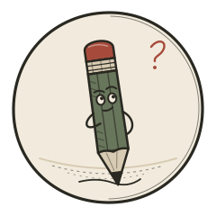

<p align="center">
  
</p>

<h1 align="center">human-craft-frontend</h1>

<p align="center">
  Skill para agentes de código que trava a geração prematura de HTML, CSS, React ou Tailwind antes de existir sentimento, moodboard real e rascunho aprovado.
</p>

---

## Por que existe

Sem restrições, agentes de IA convergem para o mesmo template: hero centralizado, grid bento de 3 cards e gradiente roxo. A `human-craft-frontend` impõe **5 portões obrigatórios** antes e depois do código.

## Os 5 Gates

1. **Gate 1 (Feeling & Opinion):** o agente para e pergunta sentimento em 3 adjetivos, superfície/material, paleta máxima (2 neutros + 1 destaque) e personalidade tipográfica.
2. **Gate 2 (Real Reference Hunting):** você busca 2 ou 3 referências concretas (`are.na`, `cosmos.so`, `godly.website`, `mobbin.com`, `tympanus.net/codrops`) e o agente extrai os tokens exatos para um `DESIGN_SPEC`.
3. **Gate 3 (Hand Sketch / Structural Map):** foto de rascunho na mão ou mapa em ASCII aprovado por você antes de criar qualquer arquivo de interface.
4. **Gate 4 (Bespoke Assets & Vector Motion):** arte orgânica via `watercolor-obj` / `watercolor-obj-p5` (`p5.brush`) e movimento vetorial ao vivo via `@lottiefiles/creator-mcp`.
5. **Gate 5 (Intentional Iteration & Anti-Slop Audit):** checagem de contraste, easing não-linear, acessibilidade por teclado e remoção de padrões genéricos.

## Instalação

Instale a skill principal no seu ambiente:

```bash
npx skills add santanaluiz181-cell/human-craft-frontend
```

### Extras de arte orgânica e animação vetorial

Para habilitar aquarela procedural (`p5.brush`) sem gastar tokens de IA:

```bash
npx skills@latest add morikyl/skills --skill watercolor-obj watercolor-obj-p5
```

Para habilitar criação e edição de Lottie JSON ao vivo, adicione no seu `mcp_config.json`:

```json
{
  "mcpServers": {
    "lottiefiles-creator": {
      "command": "npx",
      "args": ["-y", "@lottiefiles/creator-mcp@latest"]
    }
  }
}
```

## Estrutura do repositório

- [`SKILL.md`](SKILL.md): definição da skill e regras dos 5 Gates.
- [`DESIGN.md`](DESIGN.md): tokens e decisões de design do caderno de pesquisa.
- [`docs/`](docs/index.html): página showcase interativa publicada via GitHub Pages.

## Licença

MIT. Veja [`LICENSE`](LICENSE).
